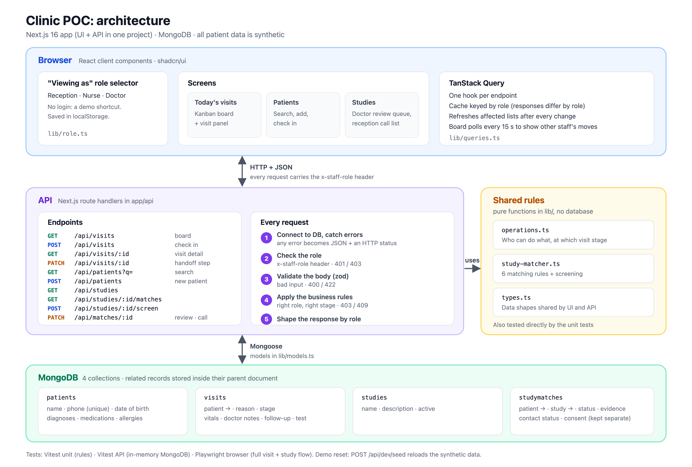

# Clinic POC

## Quick start

You need **Node.js 20.9 or newer** (developed on Node 24), npm, and a **MongoDB** connection string (for example, a free MongoDB Atlas cluster).

```bash
# 1. Install dependencies
npm install

# 2. Create your env file, then set MONGODB_URI in .env.local
cp .env.example .env.local

# 3. Start the app on http://localhost:3000
npm run dev

# 4. In a second terminal: load the synthetic demo data
#    (wipes and reloads the 4 clinic collections)
curl -X POST http://localhost:3000/api/dev/seed
```

Instead of step 4, you can click **Reset demo data** in the app's footer. It asks for confirmation, then reloads the demo data. Then pick a role with **Viewing as** in the top bar.

```bash
# Tests (use a throwaway in-memory MongoDB, never your real database)
npm test                            # unit + API tests
npx playwright install chromium     # once, before the first browser test run
npm run test:e2e                    # builds the app, then runs the browser test

# Checks and production build
npm run lint
npm run build && npm start
```

### Deploying to Vercel

1. Import the repo in Vercel and add `MONGODB_URI` as an environment variable.
2. In MongoDB Atlas, under **Network Access**, allow access from anywhere (`0.0.0.0/0`), because Vercel doesn't use fixed IP addresses.
3. After deploying, open the app and click **Reset demo data** in the footer to load the demo patients.

**Reset demo data** works on Vercel too, so reviewers can start from a clean demo. Anyone with the link can use it, and it resets the data for everyone. That's acceptable only because the database holds synthetic data. Remove or protect `POST /api/dev/seed` before the app ever holds real patient data.

## Architecture



- **Browser:** three screens plus a "Viewing as" role selector. TanStack Query calls the API and sends the role in the `x-staff-role` header.
- **API:** Next.js route handlers in `app/api`. Every request checks the role, validates the body with zod, applies the business rules and returns only what that role may see.
- **Shared rules:** plain functions in `lib/` with no database access. `operations.ts` says who can do what at each visit stage, and `study-matcher.ts` holds the 6 matching rules. The unit tests call them directly.
- **MongoDB:** 4 collections (`patients`, `visits`, `studies`, `studymatches`) through Mongoose. Vitals, notes and follow-ups are stored inside the visit; evidence, contact status and consent inside the study match.

The editable source of the diagram is [docs/architecture.svg](docs/architecture.svg).

---

A prototype for a small clinic that does two things:

1. **Visit handoff:** follow a patient from check-in through the nurse and doctor to checkout, without losing track of them.
2. **Study screening:** flag patients who might fit a research study, have a doctor check them, and let reception record calls and consent.

All data is **synthetic**. These are fictional patients, not real people.

## Run it

| Step | Command / action |
|---|---|
| 1. Install | `npm install` |
| 2. Database | Put your MongoDB connection string in `.env.local` as `MONGODB_URI=...` (see `.env.example`) |
| 3. Start | `npm run dev`, then open http://localhost:3000 |
| 4. Load demo data | Click **Reset demo data** in the footer (asks to confirm, then wipes and reloads the data) |
| 5. Tests | See [Tests](#tests) |

There's no login. Pick a role with **Viewing as** in the top bar. The server still checks what each role is allowed to do.

## Who does what

| Role | Visit | Study |
|---|---|---|
| **Reception** | Finds patients, checks them in, books follow-ups, completes checkout | Calls doctor-confirmed patients and records the outcome and consent |
| **Nurse** | Records blood pressure, weight, temperature and notes, then sends to the doctor | Nothing |
| **Doctor** | Reads everything in one place, writes notes, marks follow-up and tests, sends to checkout | Reviews flagged patients and confirms or rejects them |

Visit stages: **Checked in → With nurse → With doctor → Checkout → Done**

## How studies work

There's one example study: **Adults with diabetes** (18 or older, with a documented diabetes diagnosis).

### The journey of a study match

| # | Who | What happens | Status after |
|---|---|---|---|
| 1 | Doctor | Clicks **Run screening**. The system reads every patient's diagnoses. | **Possible match** or **Needs checking** (or nothing) |
| 2 | Doctor | Checks each flagged patient in **Studies → To review** | **Confirmed** or **Rejected** |
| 3 | Reception | Calls confirmed patients from **Studies → Still to call** | Contact: **Reached** / **Not reached** |
| 4 | Reception | If reached, records what the patient said | Consent: **Consented** / **Declined** / **Still deciding** |

A flag is **never** eligibility, and a call is **never** consent. Consent only changes when reception records the patient's answer.

### Matching rules

The system reads the patient's **diagnoses** and **date of birth**, and goes through the rules top to bottom. **The first rule that applies wins.**

| # | If the record… | Result | Example |
|---|---|---|---|
| 1 | Doesn't mention diabetes at all | No match | "Asthma" |
| 2 | Only mentions prediabetes, a family history, "no diabetes" or diabetes insipidus | No match | "Family history of diabetes" |
| 3 | Shows the patient is under 18 | No match | 15-year-old with "Type 1 diabetes" |
| 4 | Mentions diabetes but has no date of birth | **Needs checking** (age unknown) | "T2DM", no DOB |
| 5 | Says the diabetes is suspected, possible, borderline, gestational, query or "?" | **Needs checking** | "Suspected diabetes" |
| 6 | Clearly states diabetes, type 1, type 2, T1DM, T2DM or DM2 | **Possible match** | "Type 2 diabetes mellitus" |
| – | Mentions diabetes but the wording is unclear | **Needs checking** | "Diabetic retinopathy" |

How the text is read:

| Rule | Meaning |
|---|---|
| Whole words only | "DM2" inside "ADM2" doesn't count |
| Upper/lower case ignored | "T2DM" = "t2dm" |
| Prediabetes never counts as diabetes | "Prediabetes", "pre-diabetes" → no match |
| Evidence is shown | The doctor sees the exact text that caused the flag |
| Reviewed matches are kept | Running screening again never undoes a doctor's decision |

### What each status means

| Status | Who sees it | Meaning |
|---|---|---|
| Possible match | Doctor only | The record clearly says diabetes. A doctor still has to check it. |
| Needs checking | Doctor only | Something is missing or unclear. Shown in amber with what to check. |
| Confirmed | Everyone | A doctor checked it. The patient goes onto reception's call list. |
| Rejected | Doctor only | A doctor decided it doesn't fit. It disappears from the lists. |

### Demo patients (after "Reset demo data")

| Patient | Diagnosis text | Result |
|---|---|---|
| Maria Lopez | Type 2 diabetes mellitus (2015) | Possible match |
| Daniel Okafor | DM2 | Confirmed (not called yet) |
| Robert Hughes | Type 2 diabetes | Confirmed, reached, consented |
| Tom Novak | T2DM, no date of birth | Needs checking (age unknown) |
| Grace Kim | Suspected diabetes, awaiting HbA1c | Needs checking |
| Priya Shah | Gestational diabetes (2021) | Needs checking |
| Leo Fischer | Type 1 diabetes, age 15 | No match (under 18) |
| Aisha Rahman | Prediabetes | No match |
| Hannah Brooks | Family history of diabetes | No match |
| Ewa Kowalska | Diabetes insipidus | No match |
| James Carter | Asthma | No match |

## Tests

None of the tests touch your real database: the API and browser tests use a throwaway in-memory MongoDB.

| Layer | Command | What it checks | Files |
|---|---|---|---|
| Unit | `npm run test:unit` | Matching rules, screening, and the visit/study rules: who can do what at which stage, checkout blocked until the follow-up is booked, consent never set without an answer | `lib/*.test.ts` |
| API | `npm run test:api` | The real API: roles enforced on the server, reception never sees clinical data, input errors, duplicates, two staff acting at once | `tests/api/` |
| Browser | `npm run test:e2e` | The full happy path in a real browser: check-in → nurse → doctor → checkout → doctor confirms the study match → reception records a missed call, then consent | `tests/e2e/` |

`npm test` runs the unit and API tests together. The browser test builds the app first. On the first run, it needs `npx playwright install chromium`.

## Not built yet

| Item | Note |
|---|---|
| **Results review queue** | Results that arrive after a visit can still get lost. A known problem, left out on purpose to get the visit handoff right first. **Still outstanding.** |
| Login and full permissions | The role selector is a demo shortcut, not security |
| Scheduling, billing, prescriptions | Out of scope. Reception only marks a follow-up as "booked". |
| Editing diagnoses in the UI | Diagnoses come from the demo data |

## Assumptions

- "Adult" means 18 or older.
- Diagnoses, medications and notes are free text. No coding standard such as ICD.
- The matching rules are examples for the prototype, not real eligibility criteria.
